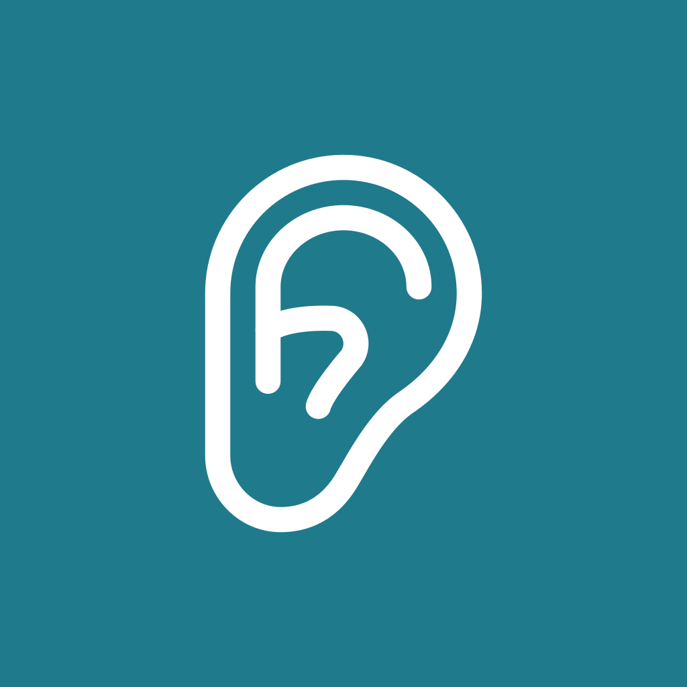
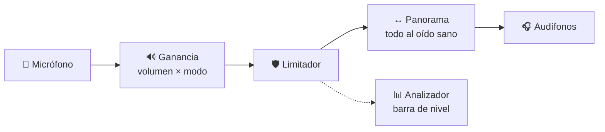

<div align="center">



# Oído+

**Ayuda auditiva para personas con pérdida de audición en un solo oído**

El teléfono capta el sonido del ambiente con el micrófono y lo reproduce **solo por el oído sano** a través de audífonos.


*Proyecto final de Programación de Dispositivos Móviles · Universidad Surcolombiana (USCO)*

</div>

---

## 👥 Equipo

| Integrante | GitHub |
| --- | --- |
| **Yhoan Sebastián Tamayo Vargas** | [@SalemOz](https://github.com/SalemOz) |
| **Delia Del Pilar Valencia Conde** | [@Delia-pi](https://github.com/Delia-pi) |

---

## 📑 Contenido

1. [¿Qué hace la app?](#-qué-hace-la-app)
2. [Cómo funciona el audio](#-cómo-funciona-el-audio)
3. [API pública y GPS](#-api-pública-y-gps)
4. [Estructura del proyecto](#-estructura-del-proyecto)
5. [Datos guardados](#-datos-guardados)
6. [Foto de perfil](#-foto-de-perfil-camera--filesystem)
7. [Instalación y ejecución](#-instalación-y-ejecución)
8. [Permisos de Android](#-permisos-de-android)
9. [Pruebas en el teléfono](#-pruebas-en-el-teléfono)
10. [Limitaciones conocidas](#️-limitaciones-conocidas)
11. [Relación con la rúbrica](#-relación-con-la-rúbrica)

---

## 📱 ¿Qué hace la app?

| Pantalla | Archivo | Qué hace |
| --- | --- | --- |
| 📝 **Formulario inicial** | `pages/onboarding` | Pide el nombre y el oído afectado (con validación). Solo aparece la primera vez. |
| 🏠 **Inicio** | `pages/home` | Activa/desactiva la amplificación, volumen, modo de ambiente, nivel de sonido en vivo y clima actual con sugerencia de modo. |
| 💚 **Bienestar** | `pages/wellness` | Información de salud en español sobre audición (MedlinePlus): temas sugeridos, buscador y enlace a la fuente. |
| 🕒 **Historial** | `pages/history` | Lista de sesiones de uso (fecha, duración, oído y modo). |
| ⚙️ **Ajustes** | `pages/settings` | Editar perfil (con foto), ayuda, acerca de, borrar historial y cerrar sesión. |

> Las pestañas Inicio / Historial / Ajustes están en `pages/tabs` (`ion-tabs` + Angular Router).

---

## 🎧 Cómo funciona el audio

Se usa la **Web Audio API** dentro del WebView de Capacitor (no hace falta un plugin nativo de audio):



- `getUserMedia` captura el micrófono con eco, supresión de ruido y control automático **desactivados** (se quiere el sonido del entorno tal cual).
- Si el oído afectado es el **izquierdo**, el sonido sale solo por el canal **derecho** (`pan = +1`) y viceversa.
- **Volumen** (0–100 %) y **modo de ambiente** (Bajo / Medio / Alto) cambian la ganancia en vivo.
- Un **limitador** (`DynamicsCompressor`) evita picos fuertes.
- Un `AnalyserNode` alimenta la barra de nivel de sonido.
- Mientras amplifica, `@capacitor-community/keep-awake` mantiene la pantalla encendida.
- Cada vez que se detiene, se guarda una sesión en el historial.

📄 Código: `src/app/core/services/audio.service.ts`

---

## 🌦️ API pública y GPS

| Servicio | Para qué | Detalles |
| --- | --- | --- |
| 🌤️ [**Open-Meteo**](https://open-meteo.com/) | Clima actual | API REST pública, sin clave. Se consulta con `HttpClient`. |
| 📍 **GPS** (`@capacitor/geolocation`) | Ubicación para el clima | Si el usuario no da permiso, se usa **Neiva** por defecto. |
| 🩺 [**MedlinePlus**](https://medlineplus.gov/spanish/) | Información de salud | API pública de la Biblioteca Nacional de Medicina de EE. UU., sin clave, con `db=healthTopicsSpanish`. |

<details>
<summary><b>Ver más detalles</b></summary>

- **Petición a Open-Meteo:**
  `GET https://api.open-meteo.com/v1/forecast?latitude=..&longitude=..&current=temperature_2m,relative_humidity_2m,weather_code,wind_speed_10m`
- **MedlinePlus** responde en XML, que se convierte a texto en `parseTopics()`. Los resultados se guardan 24 h (lo pide la política de uso) y se indica la fuente. Código: `src/app/core/services/health.service.ts`.
- **Sugerencia automática:** con lluvia, tormenta o viento fuerte, la app sugiere el modo **Alto** (esos ruidos tapan los sonidos del entorno); con clima despejado sugiere **Bajo**.

📄 Código: `src/app/core/services/weather.service.ts`

</details>

---

## 🗂️ Estructura del proyecto

El código está organizado en **core** (lógica central), **shared** (piezas reutilizables) y **pages** (pantallas).

<details>
<summary><b>Ver árbol de carpetas</b></summary>

```
src/
├── app/
│   ├── app.ts / app.config.ts / app.routes.ts   # arranque, proveedores y rutas
│   ├── core/
│   │   ├── guards/
│   │   │   └── profile.guard.ts                 # formulario solo la primera vez
│   │   ├── models/
│   │   │   ├── profile.model.ts                 # Ear, Profile, EAR_LABEL
│   │   │   ├── settings.model.ts                # AmbientMode, Settings, MODE_LABEL
│   │   │   ├── session.model.ts                 # Session
│   │   │   ├── weather.model.ts                 # Weather
│   │   │   └── index.ts                         # exporta todos los modelos
│   │   └── services/
│   │       ├── storage.service.ts               # perfil, ajustes e historial (almacenamiento local)
│   │       ├── camera.service.ts                # foto de perfil (Camera + Filesystem)
│   │       ├── audio.service.ts                 # motor de audio (Web Audio)
│   │       ├── ui.service.ts                    # avisos y diálogos (toasts y alertas)
│   │       ├── weather.service.ts               # GPS + Open-Meteo
│   │       └── health.service.ts                # MedlinePlus (información de salud)
│   ├── shared/
│   │   └── validators/
│   │       └── name.validator.ts                # validación del nombre
│   └── pages/ onboarding · tabs · home · wellness · history · settings   # .ts / .html / .scss
├── environments/
│   └── environment.ts                           # URL de las API públicas
├── theme/
│   └── variables.scss                           # colores del tema
└── styles.scss                                  # estilos globales
scripts/android-setup.mjs                        # agrega permisos al AndroidManifest
capacitor.config.ts                              # appId co.edu.usco.oidoplus, webDir www
```

</details>

---

## 💾 Datos guardados

> 🔒 **Todo queda en el teléfono.** No se envía ningún dato personal a internet; solo las coordenadas viajan a Open-Meteo para obtener el clima.

| Clave en `localStorage` | Qué guarda |
| --- | --- |
| `oido.profile` | Nombre, oído afectado y nombre del archivo de la foto (`avatar`) |
| `oido.settings` | Volumen y modo de ambiente |
| `oido.sessions` | Historial de uso (máximo 100 sesiones) |

La **foto de perfil** es la única excepción: se guarda como archivo JPEG en el almacenamiento privado de la app (`Directory.Data` de `@capacitor/filesystem`). La imagen nunca se guarda en Base64 dentro de `localStorage`.

---

## 📸 Foto de perfil (Camera + Filesystem)

| Pieza | Qué hace |
| --- | --- |
| `@capacitor/camera` | API moderna desde la 8.1: `Camera.takePhoto()` para la cámara y `Camera.chooseFromGallery()` para la galería. Ionic muestra las dos opciones con `ActionSheetController`. |
| `@capacitor/filesystem` | Copia la foto desde la caché temporal a `Directory.Data`. Guarda una sola foto (`avatar-<marca de tiempo>.jpg`) y borra la anterior al reemplazarla o al cerrar sesión. |
| `CameraService` | `src/app/core/services/camera.service.ts`. Expone `avatarUrl` y `busy` como *signals*. Ninguna página habla directo con los plugins. |

**Cómo se usa:** en Ajustes se toca el círculo del avatar → *Tomar una foto* / *Elegir de la galería*. Si ya hay una foto, aparece también **Eliminar foto**, que la quita (después de confirmar) sin tocar el nombre, el oído ni el historial. Si no hay foto, se muestra la inicial del nombre.

Para mostrarla se obtiene la ruta con `Filesystem.getUri()` y se convierte con `Capacitor.convertFileSrc()`, así sigue disponible después de cerrar y abrir la app.

> 💡 `cap sync` agrega automáticamente los plugins al proyecto Android. No hace falta agregar permisos al `AndroidManifest.xml`: Camera abre la app de cámara del sistema y Filesystem escribe en el almacenamiento privado de la app.

---

## 🚀 Instalación y ejecución

**Requisitos:** Node.js · Ionic CLI (`npm i -g @ionic/cli`) · Android Studio con JDK 21

### En el navegador

```bash
npm install                  # instala dependencias
npm start                    # abre http://localhost:4200
npm test                     # pruebas unitarias (32)
```

### En Android

```bash
ionic build                  # compila la web en www/   (equivale a: npx ng build)
npx cap add android          # solo la primera vez
npm run android:setup        # agrega permisos de micrófono y ubicación
npx cap sync android         # copia la web y registra los plugins nativos
npx cap open android         # abre Android Studio (espera el Gradle Sync)
```

> ⭐ **Regla de oro:** cada vez que cambies código, repite `ionic build` y `npx cap sync android`.

### 📦 Generar el APK

Android Studio → **Build › Generate App Bundles or APKs › Generate APKs** → *locate*.

El archivo queda en `android/app/build/outputs/apk/debug/app-debug.apk`.

---

## 🔐 Permisos de Android

| Permiso | Para qué |
| --- | --- |
| `RECORD_AUDIO` | Capturar el sonido del ambiente |
| `MODIFY_AUDIO_SETTINGS` | Ajustes de audio |
| `ACCESS_COARSE_LOCATION` / `ACCESS_FINE_LOCATION` | Ubicación para el clima |
| `INTERNET` | Consultar Open-Meteo y MedlinePlus |

Los permisos de micrófono y ubicación se piden la primera vez que se usan. La foto de perfil no agrega permisos propios.

---

## ✅ Pruebas en el teléfono

<details>
<summary><b>Ver lista de pruebas (14)</b></summary>

- [ ] Abrir la app: aparece el formulario. Probar nombre vacío, `admin`, `Ana123` → muestra error.
- [ ] Elegir oído y continuar: llega a Inicio con el saludo correcto.
- [ ] Conectar audífonos y activar **Amplificación**: aceptar permiso de micrófono; la barra de nivel se mueve.
- [ ] Comprobar que el sonido sale **solo por el oído sano** (tapar/hablar cerca del micrófono).
- [ ] Cambiar volumen y modo: el sonido cambia en vivo. Cambiar el oído en Ajustes: cambia de lado.
- [ ] Desactivar: aparece una sesión nueva en **Historial**.
- [ ] Cerrar la app por completo y abrirla: no pide el formulario y conserva perfil e historial.
- [ ] Clima: aceptar ubicación (muestra "Tu ubicación (GPS)"); negarla (muestra Neiva por defecto).
- [ ] Pestaña **Bienestar**: carga «Pérdida de audición»; tocar otro tema y buscar uno propio; «Leer en MedlinePlus» abre el navegador.
- [ ] Ajustes → **Cerrar sesión**: vuelve al formulario y borra los datos.
- [ ] Ajustes → tocar el avatar → **Tomar una foto** y **Elegir de la galería**: la foto se ve recortada en el círculo (guardar un cambio de nombre u oído no la borra).
- [ ] Cancelar la cámara o negar el permiso: se conserva la foto anterior (o la inicial) y aparece un aviso.
- [ ] Tocar el avatar → **Eliminar foto**: confirmar y volver a la inicial; nombre, oído e historial siguen igual.
- [ ] Cerrar la app por completo y abrirla: la foto de perfil sigue ahí; al cerrar sesión vuelve la inicial.

</details>

---

## ⚠️ Limitaciones conocidas

> [!WARNING]
> **Oído+ no es un dispositivo médico** ni reemplaza un audífono; es una ayuda de conciencia del entorno.

- **⏱️ Retraso (latencia):** el audio pasa por el WebView, así que hay un pequeño retraso entre el sonido real y el que se escucha. Con audífonos con cable es menor; con Bluetooth aumenta.
- **🎧 Usar audífonos:** sin audífonos, el parlante del teléfono realimenta el micrófono (pitido).
- **🔵 Audífonos Bluetooth:** al abrir el micrófono, Android pone el audio en «modo comunicación»: los botones de volumen pasan a controlar el volumen de llamada y el Bluetooth cambia al perfil de manos libres, que es **mono**. En mono no existen canales izquierdo y derecho, así que no se puede enviar el sonido a un solo oído. Por eso se recomiendan **audífonos con cable**.
- **📴 Segundo plano:** la captura funciona con la app abierta (la pantalla se mantiene encendida mientras amplifica). Seguir captando con la app minimizada requeriría un servicio nativo en primer plano.

---

## 🎓 Relación con la rúbrica

| Entrega | Cumplimiento |
| --- | --- |
| **Tercer corte** (Ionic + Angular) | `IonCard`, `IonList`, formularios reactivos validados, `HttpClient` a Open-Meteo |
| **Avance** (Capacitor) | Sincronización con Android Studio + uso funcional de **GPS** (`@capacitor/geolocation`) |
| **Evaluación final** | App funcionando, código fuente completo y APK instalado en un teléfono real |

---

<div align="center">

Hecho con 💙 en Neiva · Universidad Surcolombiana

</div>
